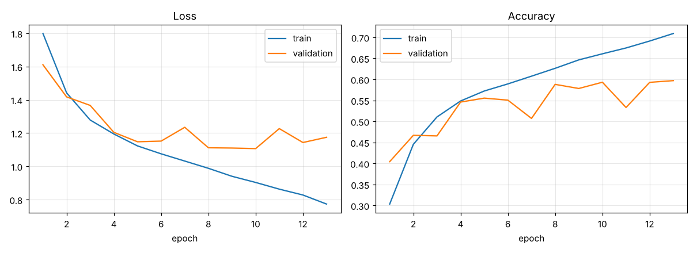

# Emotion Detector – real-time face recognition + emotion classification

A Python / OpenCV app that recognises **who** is in front of the webcam and **what emotion** they are showing, live, e.g. *"Ana is Happy"*. Built as a team project for the *Computer Vision for Vehicles* course (2022), with a use case in mind: detecting tired, stressed or distracted drivers.

## How it works

```
webcam frame ──► face detection (dlib HOG) ──► 128-d face encoding ──► match against known_faces/ ──► name
                        │
                        └──► crop · grayscale · 48×48 ──► CNN (7 classes) ──► emotion
```

1. **Face recognition** – `face_rec.py` encodes one reference photo per person with `face_recognition` (dlib) and matches each detected face by Euclidean distance between 128-d encodings. Frames are downscaled 4× before detection to keep the FPS high.
2. **Emotion classification** – each face crop goes through a convolutional neural network (Keras / TensorFlow) that predicts one of 7 emotions: angry, disgust, fear, happy, neutral, sad, surprise.
3. **Overlay** – OpenCV draws the bounding box and the label on the live video.

## Model training

The notebook [`notebooks/train_emotion_cnn.ipynb`](notebooks/train_emotion_cnn.ipynb) covers the full training pipeline:

- **Data**: 35,887 grayscale 48×48 face images in 7 classes (28,821 train / 7,066 validation), from the Kaggle *Face Expression Recognition* dataset (derived from FER-2013).
- **Architecture**: 4 convolutional blocks (Conv2D → BatchNorm → ReLU → MaxPool → Dropout, 64–512 filters) and 2 fully connected layers, softmax output.
- **Training**: Adam, categorical cross-entropy, batch size 128, with `EarlyStopping`, `ReduceLROnPlateau` and `ModelCheckpoint` callbacks.
- **Result**: about **59% validation accuracy**. For reference, human accuracy on FER-2013 is estimated at around 65%.



The live demo uses `models/emotion_model.h5`, a deeper VGG-style CNN (8 conv layers) with the same 48×48 grayscale input.

## Tech stack

Python · OpenCV · TensorFlow / Keras · face_recognition (dlib) · NumPy · pandas · matplotlib / seaborn · Jupyter

## Run it

```bash
git clone https://github.com/flavm00/emotion-face-recognition.git
cd emotion-face-recognition
python3 -m venv .venv && source .venv/bin/activate

# dlib needs CMake (macOS: brew install cmake)
pip install -r requirements.txt

# add one photo per person, the file name becomes the label
cp ~/Pictures/me.jpg known_faces/Flavius.jpg

python main.py            # press q to quit
python main.py --camera 1 # use a different webcam
```

Faces with no matching photo are labelled **Unknown**, and the emotion is still detected.

To retrain the model, download the dataset into `data/images/` (`train/` and `validation/` folders, one subfolder per emotion) and run the notebook.

## Project structure

```
emotion-face-recognition/
├── main.py                    # real-time app
├── face_rec.py                # FaceRec class: encode known faces, detect + identify
├── models/emotion_model.h5    # emotion CNN used by the app
├── notebooks/train_emotion_cnn.ipynb
├── known_faces/               # your reference photos (git-ignored)
└── docs/
    ├── training_curves.png
    └── Emotion-Detector-report-RO.pdf   # project report (Romanian)
```

## Ideas for next steps

- Swap the HOG face detector for a DNN face detector for better accuracy on angled faces.
- Use transfer learning (e.g. MobileNetV2) and data augmentation to push accuracy past 65%.
- Smooth predictions across frames to stop the label from flickering.

## Authors

- **Alexandru Flavius Morar** – [GitHub](https://github.com/flavm00)
- Mirela Georgiana Mărunt – co-author of the course project
